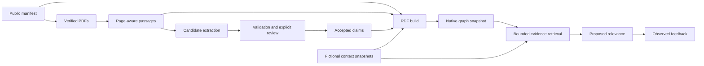

# Architecture and data contracts

## Languages and graph engine

The application definition under [apex/application](../apex/application/application.apx) is **APEXlang** (`.apx`). Its UI also includes HTML/CSS/JavaScript, and its database logic is Oracle SQL/PLSQL. The deployable [APEX SQL export](../apex/kcv-explorer.sql) is a second, engine-generated representation of the application; importing it does not require learners to author APEXlang. See [Oracle APEXlang](https://docs.oracle.com/en/database/oracle/apex/26.1/htmdb/creating-an-application-with-APEXlang.html).

The active graph implementation is **native Oracle RDF with SPARQL**, queried from SQL through `TABLE(SEM_MATCH(...))`. This repository does not implement PGQL (Property Graph Query Language), SQL/PGQ `GRAPH_TABLE`, or a SQL property graph. Property graphs mentioned in public presentation content are subjects of that content, not the graph engine used by the lab.

The [scenario evidence function](../sql/extensions/02_scenario_api.sql) selects a pinned base graph and a context-revision overlay with `SEM_MODELS(base, overlay)`. Its SPARQL matches this shape (`kcv:` denotes the project ontology namespace):

```sparql
SELECT ?item ?ver ?topic ?passage WHERE {
  ?context kcv:focusesOn ?topic .
  ?item kcv:coversTopic ?topic ; kcv:hasVersion ?ver .
  ?ver kcv:hasPassage ?passage .
}
```

This is a simplified pattern, not a complete runnable Worksheet statement. The actual code fixes the current context IRI, adds ordering/limits and embeds the SPARQL as a quoted SQL literal. `SEM_MATCH` returns variable bindings as SQL columns. PL/SQL then looks up each passage in KCV_PASSAGES and builds JSON containing evidence and actual graph paths. It bounds the packet to six distinct passages and two locators per source. R4 question execution runs and records this application-defined retrieval before model dispatch, then supplies the packet to the answer task. The retained agent tool uses the same query for its explicit tool route; the LLM does not generate arbitrary graph SQL here. See [Oracle SEM_MATCH](https://docs.oracle.com/en/database/oracle/oracle-database/26/rdfrm/using-sem_match-table-function-query-rdf-data.html).

OWL inference is a separate optional exercise, not part of normal answer retrieval. The pinned original lab uses an `owl:hasValue` restriction to classify ElectrifiedCar from a specific energy mode. Our [OWL exercise](../sql/scenarios/10_owl_inference.sql) uses `owl:someValuesFrom` plus `rdfs:subClassOf` to classify a context with a link to a Topic as FocusedContext. Both use `SEM_APIS.CREATE_INFERRED_GRAPH` with `SEM_RULEBASES('OWL2RL')` and before/after SPARQL queries. The inference mechanism is shared; the restriction and domain are adapted. The default evidence query passes no inference rulebase and does not automatically query that optional inferred graph.

## Connected evidence model

Two views meet at a contextual assessment: people/organisations/engagements and knowledge/content/evidence. Time changes both views. The ontology is [kcv.ttl](../ontology/kcv.ttl); [model.svg](../generated/model.svg) is a compact conceptual view.

## Evidence types

1. Public source identity and exact PDF edition hash.
2. Actual normalised passage, one-based PDF page and chunk/hash, held in local work files or the lab database.
3. Editorial review example: a paraphrase linked to a page for inspection, not a Claim.
4. Model candidate: statement, allowed topics, evidence ID and short exact quote; structural validation is not truth validation.
5. Accepted Claim: candidate plus an explicit reviewer/rationale, linked to its passage.
6. Relevance assessment: why a source/version may help an explicit context. Initial rankings are deterministic topic baselines, not agent results.
7. Feedback: actual observation, observer, context snapshot and graph snapshot; no feedback is pre-populated.

Topics, business domains, content form and contribution purpose are separate facets. General and Unclassified retain different meanings. Source access, authority, availability and relevance are not one confidence score.

## Pipeline



Initial source/topic metadata and review examples can be explored before any accepted Claim exists. Do not describe this metadata graph as a fully extracted document knowledge graph. The learner adds accepted claims in Lab 4.

## Agent roles

Source analysis, context clarification and relevance explanation use three specialist workers and one routing coordinator. Native DBMS_CLOUD_AI_AGENT tools return fixed, read-only JSON packets. The database source packet is capped, the context packet is selected by explicit ID and the relevance packet follows native RDF recommendations to at most six real passage records across distinct source pages. No tool accepts arbitrary SQL/SPARQL or publishes graph changes.

The native team is a controlled routing demonstration; the full ingestion workflow is ordinary Python/SQL. The separate `extract` command produces locally validated candidates, and `review` applies a deliberate acceptance/rejection decision. Agent text does not automatically enter that accepted store. Candidate, review and agent-run logs remain local/ignored.

## Evolution

The current v2 `KCV_SCENARIO` API retrieves scoped evidence in application code before sending a question to `KCV_GROUNDED_TEAM`. Its answer task has no tools and receives the recorded packet directly, including after provider-history expiry. Context-change proposals retain `KCV_EXPLORER_TEAM`. Each authenticated scenario pins an immutable base graph and creates a separate context-topic overlay. Retrieval joins both graphs and returns actual relationship bindings and passages. Explicit, typed user changes create new revisions/overlays and a new registered conversation. The model can propose an edit, but only the trusted Worksheet/APEX control can apply it with a one-use, revision-bound token. Source graphs and passages remain unchanged. See the current [migration and runtime registration guide](database-migrations.md) and [the app](../apex/README.md); the older [scenario setup](scenario-setup.md) describes the v1 raw-script route.

Trace events distinguish application retrieval from agent tool calls. Earlier events retain `LEGACY` origin internally and omit that new field from historical trace JSON; no trigger is invented for old evidence. A dispatch timestamp is recorded immediately before the model call. Evidence preparation failure stops before that boundary, records a failed attempt and returns `ORA-20174` without automatic retry. The user can review the failure and deliberately make a new attempt; an uncertain submitted call still requires explicit recovery. Successful recorded retrieval establishes the evidence supplied to the model, not correctness of its interpretation or citations.

This extension's retrieval uses topic membership with deterministic bounds, not the initial weighted offline baseline. The graph view is drawn from tool bindings rather than model-generated edges. Source relationship extraction writes separately labelled model-proposal graphs; it does not bypass the optional accepted-Claim workflow or silently feed those relationships to active retrieval.

Immutable source versions and passage identities retain hashes. Context changes increment snapshot_version. Every new RDF build hash loads into a new native graph; older snapshots are retained. Queries select an explicit context and the latest loaded snapshot. There is no model-answer cache to invalidate in this first version. Add cache keys only with context, data, ontology, retrieval and model versions.

The offline baseline uses supplied topic preferences, not learned personal interests, graph centrality or inferred organisational intent. It is deliberately simple so the lab can ask whether a more elaborate method improves an actual question.

## Boundaries and validation

Oracle Linux/Bash is the local artifact baseline; ADB Serverless 26ai is the end-to-end database target. All database actions can use Database Actions SQL Worksheet with generated/native SQL. Direct driver connections are optional automation. Provisioning, restart and IAM remain OCI control-plane steps. RDFLib validates artifact syntax/local query semantics, not Oracle API availability. Native RDF, Java setup, grants, profile access and the team need a live Serverless pass before production of a final tested release. There are no dependencies on the source research collection or its private infrastructure.
