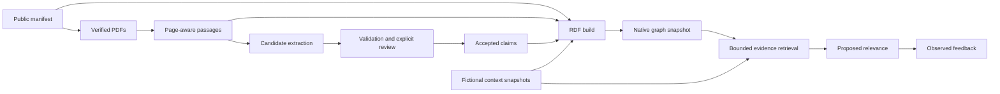

# Architecture and data contracts

Two views meet at a contextual assessment: people/organisations/engagements and knowledge/content/evidence. Time changes both views. The ontology is [kcv.ttl](../ontology/kcv.ttl); [model.svg](../generated/model.svg) is a compact conceptual view.

## Evidence types

1. Public source identity and exact PDF edition hash.
2. Actual normalised passage, one-based PDF page and chunk/hash, held in local work files or the lab database.
3. Editorial review example: a paraphrase linked to a page for inspection, not a Claim.
4. Model candidate: statement, allowed topics, evidence ID and short exact quote; structural validation is not truth validation.
5. Accepted Claim: candidate plus an explicit reviewer/rationale, linked to its passage.
6. Relevance assessment: why a source/version may help an explicit context. Initial rankings are deterministic topic baselines, not agent results.
7. Feedback: actual observation, observer, context snapshot and graph snapshot; no feedback is pre-populated.

Topics, business domains, content form and contribution purpose are separate facets. General and Unclassified retain different meanings. Source access, authority, availability and relevance are not one confidence score.

## Pipeline

Initial source/topic metadata and review examples can be explored before any accepted Claim exists. Do not describe this metadata graph as a fully extracted document knowledge graph. The learner adds accepted claims in Lab 4.

## Agent roles

Source analysis, context clarification and relevance explanation use three specialist workers and one routing coordinator. Native DBMS_CLOUD_AI_AGENT tools return fixed, read-only JSON packets. The database source packet is capped, the context packet is selected by explicit ID and the relevance packet follows native RDF recommendations to at most six real passage records across distinct source pages. No tool accepts arbitrary SQL/SPARQL or publishes graph changes.

The native team is a controlled routing demonstration; the full ingestion workflow is ordinary Python/SQL. The separate `extract` command produces locally validated candidates, and `review` applies a deliberate acceptance/rejection decision. Agent text does not automatically enter that accepted store. Candidate, review and agent-run logs remain local/ignored.

## Evolution

The optional original-style extension adds KCV_EXPLORER_TEAM and `KCV_SCENARIO`. Each authenticated scenario pins an immutable base graph and creates a separate context-topic overlay. The evidence tool joins both graphs and returns actual relationship bindings and page-linked passages. Explicit, typed user changes create new revisions/overlays and a new registered conversation. The model can propose an edit, but only the trusted Worksheet/APEX control can apply it with a one-use, revision-bound token. Source graphs and passages remain unchanged. See [scenario setup](scenario-setup.md) and [the app](../apex/README.md).

This extension's retrieval uses topic membership with deterministic bounds, not the initial weighted offline baseline. The graph view is drawn from tool bindings rather than model-generated edges. Source relationship extraction writes separately labelled model-proposal graphs; it does not bypass the optional accepted-Claim workflow or silently feed those relationships to active retrieval.

Immutable source versions and passage identities retain hashes. Context changes increment snapshot_version. Every new RDF build hash loads into a new native graph; older snapshots are retained. Queries select an explicit context and the latest loaded snapshot. There is no model-answer cache to invalidate in this first version. Add cache keys only with context, data, ontology, retrieval and model versions.

The offline baseline uses supplied topic preferences, not learned personal interests, graph centrality or inferred organisational intent. It is deliberately simple so the lab can ask whether a more elaborate method improves an actual question.

## Boundaries and validation

Oracle Linux/Bash is the local artifact baseline; ADB Serverless 26ai is the end-to-end database target. All database actions can use Database Actions SQL Worksheet with generated/native SQL. Direct driver connections are optional automation. Provisioning, restart and IAM remain OCI control-plane steps. RDFLib validates artifact syntax/local query semantics, not Oracle API availability. Native RDF, Java setup, grants, profile access and the team need a live Serverless pass before production of a final tested release. There are no dependencies on the source research collection or its private infrastructure.
