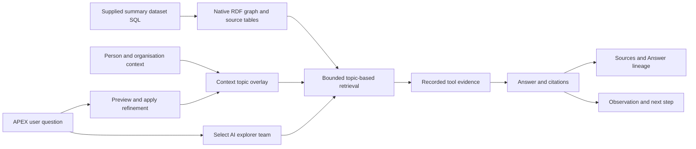

# Release architecture

A fictional person/organisation's context meets a curated graph of topics, public sources and attributed editorial summaries. The intersection helps select evidence for a question. Refinements create new context revisions; saved responses retain their historical evidence.

The [ontology](../ontology/kcv.ttl) defines the shared model; [scenario-extension.ttl](../ontology/scenario-extension.ttl) documents scenario concepts. The native graph binds a context's explicit topics to content topics, versions and evidence. Retrieval is deterministic and bounded, not vector similarity or a learned relevance ranking. Context weights do not drive ordering.

Release evidence is editorial summary text with its own ID/hash, original source edition hash and public page link. See [dataset semantics](release-dataset.md). It is not full source text or an automatically accepted claim. Model answers distinguish proposed relevance from observed value. Roadmap and regional limitations remain visible.

APEX invokes the database API and KCV_EXPLORER_TEAM. The team has a question worker, a change planner and coordinator; no external Python service is involved. The planner proposes changes only. The user previews/applies structured refinements. The response explanation shows recorded execution/tool payloads and citation links, not private model reasoning. Saving an observation does not retrain the model or automatically alter the curated graph.

ADB Serverless supplies SQL/PLSQL, Java/RDF, Select AI and APEX; OCI Generative AI supplies model inference with configured IAM access. No Object Storage, external graph database, queue or application server is required for this path. Developer preparation/extraction/testing tools are available on dev with separate setup instructions.
