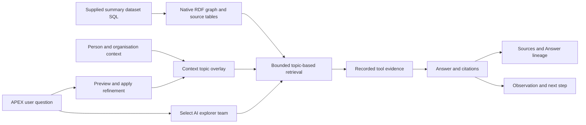

# Release architecture

A fictional person/organisation's context meets a curated graph of topics, public sources and attributed editorial summaries. The intersection helps select evidence for a question. Refinements create new context revisions; saved responses retain their historical evidence.



The [ontology](../ontology/kcv.ttl) defines the shared model; [scenario-extension.ttl](../ontology/scenario-extension.ttl) documents scenario concepts. The native graph binds a context's explicit topics to content topics, versions and evidence. Retrieval is deterministic and bounded, not vector similarity or a learned relevance ranking. Context weights do not drive ordering.

Release evidence is editorial summary text with its own ID/hash, original source edition hash and public page link. See [dataset semantics](release-dataset.md). It is not full source text or an automatically accepted claim. Model answers distinguish proposed relevance from observed value. Roadmap and regional limitations remain visible.

APEX invokes the database API and KCV_EXPLORER_TEAM. The team has a question worker, a change planner and coordinator; no external Python service is involved. The planner proposes changes only. The user previews/applies structured refinements. The response explanation shows recorded execution/tool payloads and citation links, not private model reasoning. Saving an observation does not retrain the model or automatically alter the curated graph.

ADB Serverless supplies SQL/PLSQL, Java/RDF, Select AI and APEX; OCI Generative AI supplies model inference with configured IAM access. No Object Storage, external graph database, queue or application server is required for this path. Developer preparation/extraction/testing tools are available on dev with separate setup instructions.


## How SPARQL supports a question

The collection stores RDF relationships in Oracle's native graph engine. The current context revision supplies topic links; the pinned source graph supplies content, versions and evidence links. The supplied evidence tool runs SPARQL through Oracle SQL's `SEM_MATCH` table function over both graphs.

Using `kcv:` for the collection namespace, its pattern is:

```sparql
SELECT ?item ?ver ?topic ?passage WHERE {
  ?context kcv:focusesOn ?topic .
  ?item kcv:coversTopic ?topic ; kcv:hasVersion ?ver .
  ?ver kcv:hasPassage ?passage .
}
```

This is a schematic pattern, not a complete Worksheet statement. The [implementation](../sql/extensions/02_scenario_api.sql) fixes the current context IRI, quotes the SPARQL into SQL and adds ordering/limits. The result variables become SQL columns. PL/SQL retrieves each matched summary's text and metadata and returns JSON with actual graph paths, capped at six distinct pages and two per source.

The model calls this predefined evidence tool. Its natural-language answer interprets the returned material; it does not invent the graph connections displayed by APEX. The saved response explanation retains the actual tool output and context revision. The [developer learning lab](../labs/understand-collection/understand-collection.md) lets you inspect the same boundary through SQL and the app.

Optional OWL2RL SQL demonstrates class entailment. Normal question retrieval does not automatically run that inference exercise or consume its inferred graph.

## How APEXlang relates to deployment

The app is authored as APEXlang (`.apx`) application definitions, together with HTML/CSS/JavaScript UI assets and a SQL/PLSQL backend. The authoring source and rebuild tools are available on dev for people adapting their own implementation.

For this release, the prepared app was imported into APEX and exported by the APEX engine as [kcv-explorer.sql](../apex/kcv-explorer.sql). The [Worksheet installer](../sql/install/20_install_apex.sql) wraps that export with workspace/parsing-schema installation settings and allocates a new application ID. It already includes the runtime UI assets.

A learner can install the supplied SQL without writing APEXlang, running Python or installing SQLcl. A developer learning the collection can study how the definitions, export, API and running UI relate. Someone changing the app's definition or behaviour follows the separate dev build/validate/import/export journey. See [APEX deployment notes](../apex/README.md).
