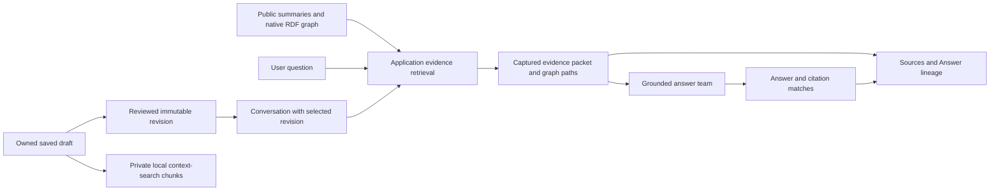

# Release architecture

The app connects an owned learning context to a curated public collection. It selects bounded evidence, asks a model to interpret that evidence and retains the answer's context, evidence and citation links.



## Public knowledge and personal runtime data

The [ontology](../ontology/kcv.ttl) and [scenario extension](../ontology/scenario-extension.ttl) describe content, versions, evidence, topics and context relationships. The dataset contains public references, attributed editorial summaries and three fictional contexts. A source edition hash identifies original material; a summary ID/hash identifies the text actually supplied to the model. Follow original links to verify claims.

My Contexts adds owned drafts, immutable ready revisions, private RDF overlays, conversations, observations and response traces. These are database runtime records, not additions to the public dataset or GitHub repository. Sharing an app login shares its library. Separate accounts have separate ownership; a URL checksum is not the ownership decision.

Saving does not publish a ready revision. Review/apply creates one. Existing conversations keep their selected revision until explicit adoption of the latest ready revision. Historical answers keep their original context/evidence. A new public collection is adopted deliberately; it does not rewrite earlier answers.

## How SPARQL supports a question

The application retrieves evidence **before** calling `KCV_GROUNDED_TEAM`. SQL/PLSQL executes SPARQL through Oracle's `SEM_MATCH` table function over the selected context overlay and pinned public graph. This is a schematic relationship, not a complete Worksheet statement:

```sparql
SELECT ?item ?ver ?topic ?passage WHERE {
  ?context kcv:focusesOn ?topic .
  ?item kcv:coversTopic ?topic ; kcv:hasVersion ?ver .
  ?ver kcv:hasPassage ?passage .
}
```

The [scenario API](../sql/extensions/02_scenario_api.sql) supplies actual identifiers, ordering and bounds. Any selected topic can match. Curriculum sources precede catalogue IDs; the packet contains at most six passages and two locators per source version. This public-evidence selection is a deterministic topic join, not vector search. Topic weights do not rank it.

Objective, role, background and constraints inform interpretation; they are not additional source filters. Removing a topic changes learning focus rather than technical capability. Objective-only edits can legitimately leave selected evidence unchanged.

The grounded answer task receives the captured packet. Proposal handling retains the separate explorer team. New trace events distinguish application retrieval from agent tools; older events retain their historical representation. Sources and Answer lineage show recorded inputs, paths and citation matches, not hidden reasoning or a correctness score. Unsupported/incomplete answers remain visibly incomplete.

## Private context search is separate

My Contexts searches saved titles/details using literal text and optional local embeddings from `KCV_CONTEXT_MINILM`. Account/status restrictions apply before ranking; results show the saved objective and match reason. Private derived chunks exclude transcripts, evidence and observations. They are removed with a permanently deleted context and are not redistributed.

Local embeddings run inside Oracle Database: library search sends no context to an external embedding/chat service. A chat question does send context/evidence to the configured model service. Keyword fallback is visible when embeddings are unavailable. See [context search](context-search.md).

## How APEXlang relates to deployment

Dev maintains native APEXlang (`.apx`) definitions, UI assets and database APIs. Release supplies the APEX-engine SQL export and prepared new/upgrade Worksheet installers. Learners do not compile APEXlang, install SQLcl or run Python. Installation uses the ordered schema bundles and a matching export; replacing isolated package files is not the v2 migration route.

ADB Serverless supplies SQL/PLSQL, Java/RDF, local vector inference, Select AI and APEX. The configured OCI model service supplies chat inference. No external graph database, queue or application server is required. Embedding model weights are obtained separately with their own attribution; they are not bundled.

## What this example does not establish

Observations record what the user checked and what to consider next. They do not automatically refine context, retrain a model, modify curated facts or prove business outcomes. Optional OWL exercises demonstrate class entailment separately. The broader learning loop and evaluation of the Explorer are future work, outside this release journey.

Continue with [app use](../labs/my-contexts/my-contexts.md), [developer learning](../labs/understand-collection/understand-collection.md) or [installation paths](installation-paths.md).
