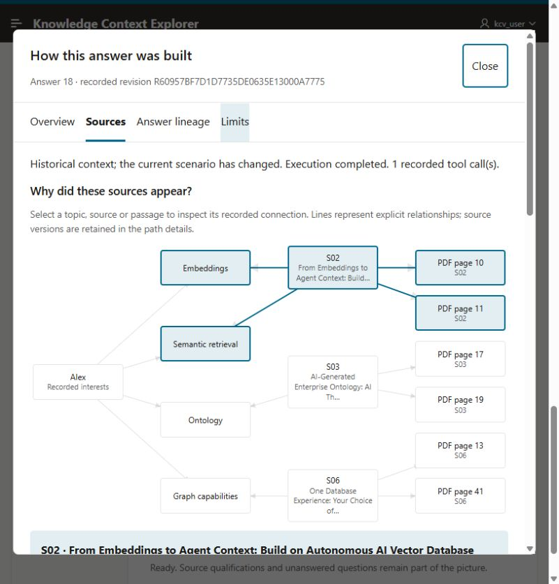
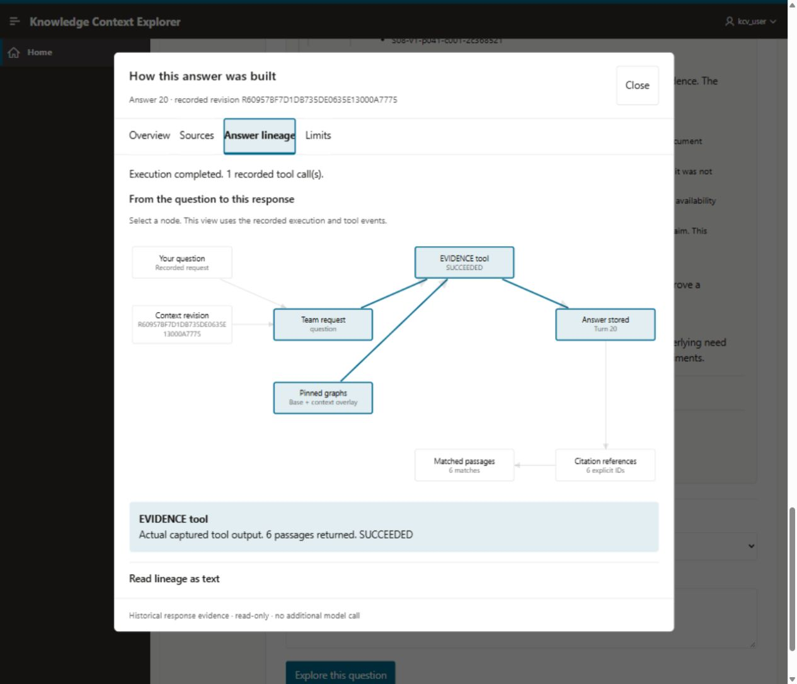

# Explore Evidence and Refine the Context

## Introduction

Experience how the graph helps select evidence, how that evidence supports a response and how a narrower context changes the next conversation. No SQL is required in this lab.

Estimated Lab Time: 20–30 minutes including source reading and model responses; planning estimate.

### Objectives

In this lab, you will:

- Ask an evidence-grounded question for Alex.
- Inspect Sources and Answer lineage graphs for one response.
- Refine topic focus and compare current versus historical evidence.
- Save an observation and next step.

### Prerequisites

Your facilitator has supplied a working Knowledge Context Explorer URL and an app login (KCV_USER in the supplied example). You need only a browser and that login. No OCI Console, SQL Worksheet or deployment work is required for this user experience. If you are setting up the environment yourself, follow the separate deployment guide first.

## Task 1: Start with Alex and ask a question

**Where:** Knowledge Context Explorer. **Account:** KCV_USER.

1. Select **Alex · engineering information discovery** and click **Start a new conversation**. Read Current understanding. Use **Evidence** to inspect the initial connections, then return to **Conversation**.

2. Keep Conversation intent set to **Explore and ask about content**. Paste the question below into Your question or new thought and click **Explore this question**:

   ```text
   <copy>
   Which sources could help Alex find existing project information, and what do they not establish?
   </copy>
   ```

3. Wait for Ready or an error. Model requests can take a minute or more. Do not click repeatedly to check progress.

**Expected outcome:** the answer discusses the connected sources and their limitations. The release uses summaries rather than the extracted text shown in the screenshots. With the supplied baseline, S02, S03 and S06 appear in the evidence set. Wording varies; a confident answer without supporting evidence is not the objective.

## Task 2: Inspect this answer's sources

1. Under the assistant response, click **How was this answer built?** The Sources tab is selected by default.

2. Select a topic, source or page node. Read the highlighted connection and the complete saved editorial summaries below. Follow a public PDF page link to check its context.

3. Distinguish **Cited in this answer** from evidence that was returned but not explicitly cited. A citation match establishes traceability to a supplied passage, not that every statement is correct.

   

**Expected outcome:** you can explain why a source was selected and locate its detail. This real screenshot is from the validated demonstration; your turn/revision IDs, selection and wording can differ. A graph connection alone does not establish suitability or observed value.

## Task 3: Inspect answer lineage

1. Select **Answer lineage**. Click the EVIDENCE tool node or Pinned graphs node to see what was captured for this response.

2. Open **Overview** for the recorded question, context and event timestamps. Open **Limits** for retrieval/capture boundaries. The graph depicts observable data flow and reference links, not private model reasoning.

3. Close the popup or press Escape to return to the answer. Opening the popup does not call the model or change the context.

   

**Expected outcome:** the response is linked to an execution, actual tool output and citation metadata. If structured citations cannot be read, matching is labelled unavailable rather than silently treated as zero. Answers created before trace capture show an earlier-response notice.

## Task 4: Refine the focus and compare

1. Open **Context**. Choose **Remove an area of focus**, select **Graph capabilities**, then click **Preview refinement**. Review the proposed operation; nothing has changed yet.

2. Click **Apply this refinement**, then open **Evidence**. Read the change summary and source cards.

3. Return to Conversation and ask:

   ```text
   <copy>
   With Graph capabilities removed from the stored context, which returned sources should Alex explore first and what remains unproven?
   </copy>
   ```

4. Open each answer's explanation and compare. Reload the page and reopen the first answer if you want to check persistence rather than browser memory.

**Expected outcome:** the current selection drops S06 and includes S08 with the supplied dataset and page cap. The older answer retains its original revision/evidence, including S06. The new answer uses the revised context. This demonstrates changed selection, not a measured improvement. Clarifying only the objective can legitimately leave the topic-based selection unchanged.

## Task 5: Capture learning and choose the next step

1. Open **Observations**. Choose how you checked understanding: a source check, discussion, dot vote, practical test or another approach.

2. Describe what you actually observed and enter the next question, idea or step. Click **Save observation**.

3. Decide whether to continue exploring, narrow the question further or finish with a concrete reading/conversation action. An experiment is one possible next step, not a required outcome.

**Expected outcome:** the status confirms the observation was saved against the current revision. This records feedback; it does not retrain the model, certify source claims or automatically apply a refinement. You have completed the main beginner path.

To understand how the collection works as a developer, continue to [Understand the collection](../understand-collection/understand-collection.md). To build a different implementation, use the dev branch.

For a longer app journey, use the [detailed UI walkthrough](../../docs/ui-walkthrough.md). To retire the temporary environment, follow the [cleanup guidance](../../docs/cleanup.md) deliberately; this lab does not automatically delete resources.

## Learn More

- [Taxonomy, ontology and data contracts](../../docs/architecture.md)
- Additional scenarios and optional exercises (technical reference on the dev branch: `labs/07_original_workshop_scenarios.md`)

## Acknowledgements

- **Author** — Jason Lowe, standalone adaptation
- **Last Updated** — November 2026
